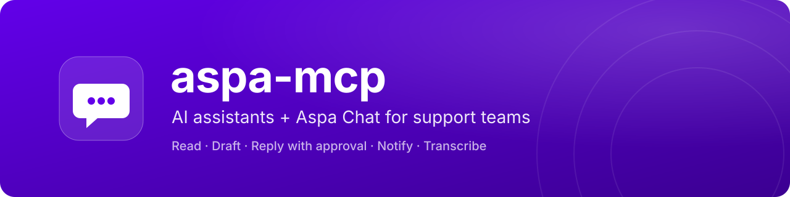
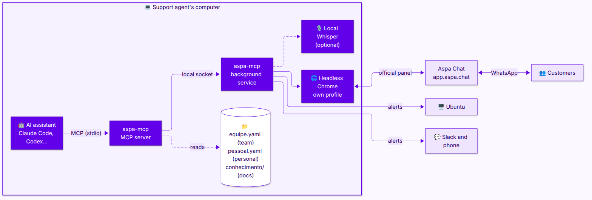
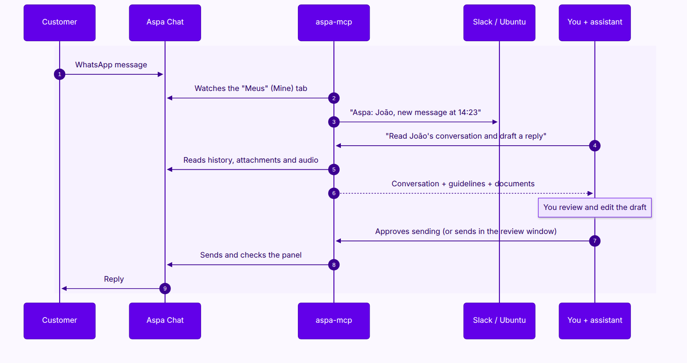

<p align="center">
  
</p>

<p align="center">
  
  
  
  
  
  
  
</p>

<p align="center">
  🇧🇷 <a href="README.md">Português</a> · 🇺🇸 English
</p>

<p align="center">
  <b>Handle Aspa Chat support by talking to your AI assistant (Claude Code, Codex and others).</b><br>
  It reads conversations, understands audio and attachments, writes in your team's tone<br>
  and only sends, transfers or concludes after you approve.
</p>

---

## Highlights

| Feature | What it does |
| --- | --- |
| 💬 **Reads everything** | Conversations, history, images, PDFs and audio (with optional local transcription). |
| ✍️ **Writes in your tone** | Team tone, signature, rules and examples, plus company documents as the source of facts. |
| ✅ **You approve** | Nothing is sent, transferred or concluded without your confirmation, in the assistant or in Aspa's review window. |
| 🔔 **Alerts at the right time** | Ubuntu, Slack and phone, only for your conversations and only during your hours. |
| 🔒 **Stays on your computer** | Session, attachments, documents and audio never leave your machine. |

## Quick start

You need: Linux with systemd (Ubuntu tested), Node.js 22.12 or newer, Google Chrome, an Aspa account and an AI assistant (Claude Code, Codex or another MCP client).

1. **Download and install**

   ```sh
   git clone <repository-url> ~/dev/aspa-mcp
   cd ~/dev/aspa-mcp && npm install
   npm run install-service && npm run init-config
   ```

2. **Connect your assistant**

   ```sh
   # Claude Code (full, sends after your approval)
   claude mcp add --scope user aspa -- node "$HOME/dev/aspa-mcp/index.mjs"

   # Codex or another client (safe mode: reads, summarizes and opens drafts; you send in Aspa)
   codex mcp add aspa --env ASPA_READ_ONLY=1 -- node "$HOME/dev/aspa-mcp/index.mjs"
   ```

3. **Ask the assistant to set it up**:

   ```text
   Help me set up Aspa.
   ```

   It logs into Aspa with you and configures company, tone, signature, documents and alerts, one item at a time.

4. **Slack alerts** (optional): `npm run slack -- <your Slack member ID>` and paste the token when asked.

5. **Use it**: *"List my Aspa conversations and tell me which ones are unread."*

Full step-by-step guide with every command explained: [docs/en/installation.md](docs/en/installation.md).

## Documentation

| Guide | Contents |
| --- | --- |
| [Installation](docs/en/installation.md) | Requirements and step-by-step setup |
| [Usage](docs/en/usage.md) | Support workflow, rules and example requests |
| [Configuration](docs/en/configuration.md) | Tone, rules, example replies, company documents, when to get alerts, templates and a complete example |
| [Notifications](docs/en/notifications.md) | Ubuntu, Slack (direct to you) and phone |
| [Audio transcription](docs/en/transcription.md) | Local Whisper, optional |
| [Other MCP clients](docs/en/other-clients.md) | Codex, Antigravity, opencode, Grok Bot, Z Code and read-only mode |
| [Security and privacy](docs/en/security.md) | Approval, audit log, data protection (LGPD), secrets |
| [Scope](docs/en/scope.md) | What aspa-mcp does and does not do, and Aspa panel limits |
| [Troubleshooting](docs/en/troubleshooting.md) | Common errors, updating and service commands |
| [Reference](docs/en/reference.md) | Components, every tool, variables and commands |

## How it works

<p align="center">
  
</p>

<sub>Editable diagram source: <a href="assets/architecture.en.mmd"><code>assets/architecture.en.mmd</code></a></sub>

The **background service** keeps a headless Chrome logged into Aspa, runs one panel action at a time and watches for new messages. The **MCP server** is the bridge to the assistant (Claude Code, Codex or another MCP client) and also serves the team's guidelines and documents.

### A support conversation from start to finish

<p align="center">
  
</p>

<sub>Editable diagram source: <a href="assets/flow.en.mmd"><code>assets/flow.en.mmd</code></a></sub>

## Tested with

| Component | Version |
| --- | --- |
| System | Ubuntu 26.04.1 LTS (GNOME Shell 50.1, X11, kernel 7.0) |
| Claude Code | 2.1.318 |
| Model | Claude Opus 5.5 (`claude-opus-5-5`) |
| Also tested on | Codex CLI 0.167.0 (another support agent, Ubuntu 26.04.1 LTS) |
| Node.js | 22.23.2 |
| Google Chrome | 157.0.8103.38 |
| Python (transcription) | 3.14.4 with faster-whisper 1.2.1, `small` model, CPU |
| Test date | November 2026 |

Tested end to end: login, reading, attachments (image, PDF, audio), transcription, sending text, attachments and templates, conclude, reopen, snooze, rename contact and Ubuntu notifications. Also tested: assume, transfer, create contact, review window, filters, search, statistics, reply quoting a message and snooze until a date. Video attachments: download only. On Codex, a second support agent tested installation, guided setup and reading, without sending anything (details in [Other clients](docs/en/other-clients.md)).

## Security in one sentence

Nothing is sent, transferred or concluded without your approval, every action first checks that the open conversation is the right one, and everything is written to a local audit log. Details in [Security and privacy](docs/en/security.md).

## Roadmap

- [x] Reading, attachments, local transcription and sending with approval
- [x] Conclude, reopen, snooze, rename and assume conversations
- [x] Notifications on Ubuntu, Slack (direct to each person) and phone
- [x] Team and personal configuration: tone, rules, examples, documents, hours and channels
- [x] Audit log of every action taken in Aspa
- [x] Review window to edit and send the draft in Aspa itself
- [x] List filters and sorting, search in conversations, concluded conversations and contacts
- [x] Mark as unread, read without marking, reply quoting a message, snooze until a date and time
- [x] Statistics and quick replies
- [x] Notifications by agent, contact and new conversation
- [x] Transfer, assuming another agent's conversation and contact creation tested live
- [x] Read-only mode for other MCP clients
- [x] Guided setup by the MCP itself (checklist, settings, documents, Slack and alert test)
- [x] Automatic draft in Slack when the customer replies (summary, transcribed audio and suggested reply)
- [ ] GPU transcription (CUDA)
- [ ] Use quick replies automatically in drafts (the account has none yet)
- [ ] Edit contact e-mail and company; agent status
- [ ] Interactive tests on Antigravity, opencode (DeepSeek, GLM, Kimi), Grok Bot and Z Code
- [ ] Journeys and tags, once configured in the account
- [ ] Official Aspa API instead of panel automation, when available
- [ ] Message webhook: drop the browser and offer a claude.ai connector

## License

[MIT](LICENSE). Independent project, not affiliated with Aspa. Changes per version: [CHANGELOG](CHANGELOG.md). Security issues: [SECURITY.md](SECURITY.md). Contributing: [CONTRIBUTING.md](CONTRIBUTING.md).
