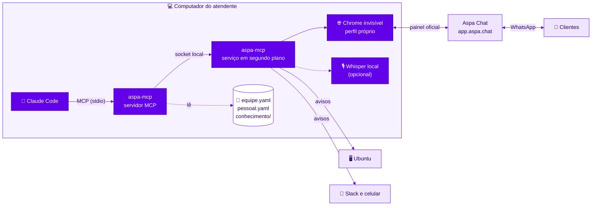
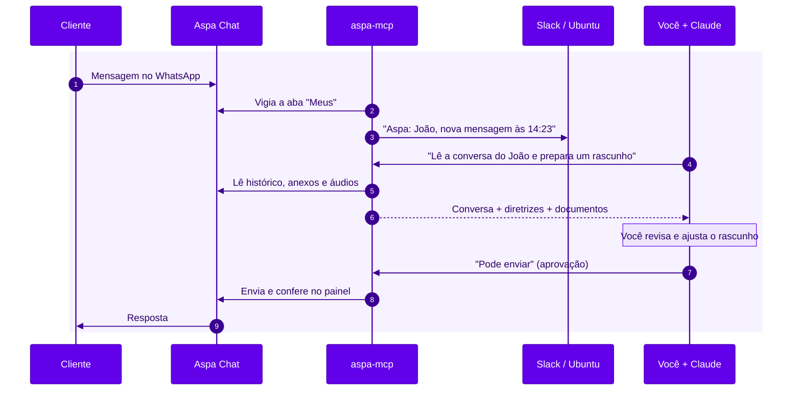

<p align="center">
  
</p>

<p align="center">
  
  
  
  
  
</p>

<p align="center">
  <b>Atenda pelo Aspa Chat conversando com o Claude.</b><br>
  Ele lê as conversas, entende áudios e anexos, escreve no tom da sua equipe<br>
  e só envia, transfere ou conclui depois da sua aprovação.
</p>

---

## Destaques

| Recurso | O que faz |
| --- | --- |
| 💬 **Lê tudo** | Conversas, histórico, imagens, PDFs e áudios (com transcrição local opcional). |
| ✍️ **Escreve no seu tom** | Tom, assinatura, regras e exemplos da equipe, mais documentos da empresa como fonte. |
| ✅ **Você aprova** | Nada é enviado, transferido ou concluído sem a sua confirmação no Claude Code. |
| 🔔 **Avisa na hora certa** | Ubuntu, Slack e celular, só das suas conversas e só no seu horário. |
| 🔒 **Fica no seu computador** | Sessão, anexos, documentos e áudios não saem da sua máquina. |

## Sumário

1. [Como funciona](#como-funciona)
2. [Testado com](#testado-com)
3. [Antes de começar](#1-antes-de-começar)
4. [Instalação passo a passo](#2-instalação-passo-a-passo)
5. [Como usar no dia a dia](#3-como-usar-no-dia-a-dia)
6. [Exemplos de pedidos](#4-exemplos-de-pedidos)
7. [Personalização: tom, regras e documentos](#5-personalização-tom-regras-e-documentos)
8. [Notificações (Ubuntu e Slack)](#6-notificações-ubuntu-e-slack)
9. [Transcrição de áudio (opcional)](#7-transcrição-de-áudio-opcional)
10. [Problemas comuns](#8-problemas-comuns)
11. [O que faz e o que não faz](#9-o-que-faz-e-o-que-não-faz)
12. [Segurança e privacidade](#10-segurança-e-privacidade)
13. [Referência técnica](#11-referência-técnica)
14. [Roadmap](#12-roadmap)

---

## Como funciona



O **serviço em segundo plano** mantém um Chrome invisível logado no Aspa, executa uma ação por vez no painel e vigia mensagens novas. O **servidor MCP** é a ponte com o Claude Code e também entrega as diretrizes e os documentos da equipe.

### Um atendimento do começo ao fim



---

## Testado com

| Componente | Versão |
| --- | --- |
| Sistema | Ubuntu 26.04.1 LTS (GNOME Shell 50.1, X11, kernel 7.0) |
| Claude Code | 2.1.318 |
| Modelo | Claude Opus 5.5 (`claude-opus-5-5`) |
| Node.js | 22.23.2 |
| Google Chrome | 157.0.8103.38 |
| Python (transcrição) | 3.14.4 com faster-whisper 1.2.1, modelo `small`, CPU |
| Data dos testes | novembro de 2026 |

Testado de ponta a ponta: login, leitura, anexos (imagem, PDF, áudio), transcrição, envio de texto, anexo e template, concluir, reabrir, adiar, renomear contato e notificações no Ubuntu. Ainda não testado ao vivo: transferir e anexos de vídeo.

---

## 1. Antes de começar

| Item | Como conferir |
| --- | --- |
| Linux com systemd (Ubuntu recomendado) | `systemctl --user status` funciona |
| Node.js 20 ou mais novo | `node --version` |
| Google Chrome | `google-chrome --version` |
| Claude Code | `claude --version` |
| Conta no Aspa com acesso ao painel de atendimento | você consegue entrar em https://app.aspa.chat |
| Acesso a este repositório | peça o link a um admin da organização |

> No macOS funciona, mas o serviço precisa ser iniciado à mão (veja [Problemas comuns](#8-problemas-comuns)).

---

## 2. Instalação passo a passo

Faça uma vez só. Leva uns 5 minutos.

### Passo 1: baixar o projeto

```sh
git clone <link-do-repositório> ~/dev/aspa-mcp
cd ~/dev/aspa-mcp
npm install
```

### Passo 2: instalar o serviço em segundo plano

```sh
npm run install-service
```

Isso cria o serviço `aspa-mcp`, que fica rodando sozinho e liga junto com o computador. Para conferir:

```sh
systemctl --user status aspa-mcp
```

Deve aparecer `active (running)`.

### Passo 3: criar os arquivos de configuração

```sh
npm run init-config
```

Cria `~/.config/aspa-mcp/equipe.yaml`, `~/.config/aspa-mcp/pessoal.yaml` e a pasta `~/.config/aspa-mcp/conhecimento/`. Você personaliza depois (veja a [seção 5](#5-personalização-tom-regras-e-documentos)).

### Passo 4: conectar ao Claude Code

```sh
claude mcp add --scope user aspa -- node "$HOME/dev/aspa-mcp/index.mjs"
```

### Passo 5: fazer login no Aspa

```sh
npm run smoke -- --login
```

1. Abre uma **janela do Chrome** no Aspa.
2. Entre com o **seu** e-mail e senha do Aspa.
3. Quando o painel carregar, a janela **fecha sozinha**.

> Sua senha é digitada só nessa janela. Ela não passa pelo Claude nem fica salva no projeto.

### Passo 6: testar

```sh
npm run smoke -- "Nome de um contato"
```

Troque pelo nome de alguém na lista de atendimentos. O comando mostra quantas conversas existem, as mensagens desse contato e os templates disponíveis.

### Passo 7: reiniciar o Claude Code

Feche e abra o Claude Code, digite `/mcp` e confira se `aspa` aparece como **connected**.

✅ **Instalação concluída.** Personalização, Slack e transcrição são opcionais.

---

## 3. Como usar no dia a dia

Abra o Claude Code em qualquer pasta e **peça em português**, como pediria a um colega.

### Fluxo recomendado

1. **Ver o que chegou**
   > Lista as conversas do Aspa e me diz quais estão não lidas.
2. **Entender o problema**
   > Lê a conversa do João e resume em 3 linhas. Se tiver áudio, transcreve. Se tiver imagem, me diz o que aparece.
3. **Pedir um rascunho**
   > Prepara um rascunho de resposta. Não envie ainda.

   O Claude consulta automaticamente o tom, as regras e os documentos da equipe.
4. **Revisar**: peça ajustes se quiser ("mais curto", "explica melhor o passo 2").
5. **Enviar**
   > Pode enviar.

   O Claude Code mostra uma **caixa de permissão** com o texto exato. Confira e aprove.
6. **Organizar**
   > Conclui a conversa do João.

### Regras importantes

- **Nada é enviado sem a sua aprovação.** Enviar, transferir, adiar, concluir, reabrir e renomear sempre abrem uma caixa de permissão.
- **Nunca marque "sempre permitir"** para essas ferramentas. Aprove uma por uma.
- **Janela de 24h do WhatsApp**: depois de 24h sem mensagem do cliente, só dá para enviar **templates**. O Claude avisa e sugere um.
- **Abrir uma conversa pode marcá-la como lida** no painel do Aspa.

---

## 4. Exemplos de pedidos

### Ler e entender

```text
Lista as conversas abertas do Aspa e me diz quais estão como não lidas.
```

```text
Lê a conversa do João no Aspa e resume o problema em 3 linhas.
```

```text
Lê a conversa da Maria (carregue mais 2 vezes o histórico), baixa os anexos e me diz o que aparece nas imagens e no PDF.
```

```text
Transcreve os áudios da conversa do João e me diz o que ele pediu.
```

```text
Passa por todas as conversas em que a última mensagem é do cliente e, para cada uma, me dá: contato, resumo de 1 linha e rascunho de resposta. Não envie nada.
```

```text
Lê a conversa do cliente ACME e verifica no código do nosso sistema se o comportamento que ele relata é esperado. Depois prepara um rascunho explicando ao cliente.
```

### Responder

```text
Prepara um rascunho de resposta para o João. Só envie depois que eu aprovar.
```

```text
Pode enviar o rascunho que aprovei para o João.
```

```text
A janela de 24h da conversa da Maria fechou. Lista os templates e envia o "Iniciar-conversa-manhã".
```

```text
Envia para o João o PDF /home/eu/Downloads/manual.pdf com a legenda "Segue o manual".
```

### Organizar

```text
Assume a conversa do João (transfere para mim).
```

```text
Transfere a conversa da Maria para o time Comercial com o comentário "cliente quer upgrade".
```

```text
Adia a conversa do João por 1 dia.
```

```text
Conclui a conversa do João.
```

```text
Reabre a conversa do João que foi concluída ontem.
```

### Configuração e sessão

```text
Quais são as diretrizes de resposta da equipe e quais documentos você tem sobre a empresa?
```

```text
O que os nossos documentos dizem sobre prazo de cancelamento?
```

```text
Minha sessão do Aspa expirou, faz o login de novo.
```

---

## 5. Personalização: tom, regras e documentos

Tudo é configurável em arquivos simples, em `~/.config/aspa-mcp/`:

| Arquivo | Quem edita | Para quê |
| --- | --- | --- |
| `equipe.yaml` | a equipe (igual para todos) | Sobre a empresa, tom, assinatura padrão, regras, exemplos, documentos, notificações padrão |
| `pessoal.yaml` | cada atendente | Sua assinatura, seus horários e canais de aviso. **Tem prioridade** sobre o da equipe |
| `conhecimento/` | a equipe | Documentos que ensinam o Claude sobre a empresa |

**As mudanças valem na hora**, sem reiniciar nada. Os modelos comentados estão em [`exemplos/`](exemplos/).

```sh
nano ~/.config/aspa-mcp/equipe.yaml
nano ~/.config/aspa-mcp/pessoal.yaml
```

> Como o repositório é público, **não** coloque estes arquivos nele. Compartilhe o `equipe.yaml` e os documentos com o time por um canal privado.

### 5.1 Sobre a empresa e tom dos rascunhos

```yaml
empresa:
  nome: "Nome da empresa"
  descricao: >
    O que a empresa faz, para quem e qual é o principal produto.

rascunhos:
  idioma: pt-BR
  tom: "Cordial, objetivo e sem jargão técnico. Trate o cliente por você."
  assinatura: "Equipe de Suporte"
  saudacao_por_horario: true        # Bom dia / Boa tarde / Boa noite
  tamanho_maximo: "até 6 linhas"
  sempre:
    - "Confirme o entendimento do problema antes de propor a solução."
  nunca:
    - "Prometer prazos ou preços que não estejam nos documentos."
    - "Pedir senha ou código de verificação ao cliente."
  quando_usar_template: "Quando a janela de 24h do WhatsApp estiver fechada."
  exemplos:
    - situacao: "Cliente diz que não consegue acessar o sistema"
      resposta: |
        Boa tarde, Maria! Sinto muito pelo transtorno.
        Você consegue me dizer se aparece alguma mensagem de erro na tela?
        Equipe de Suporte
```

| Campo | O que faz |
| --- | --- |
| `empresa.nome`, `empresa.descricao` | Contexto sobre a empresa para todo rascunho |
| `rascunhos.tom` | Como escrever (formal, informal, "você" ou "senhor") |
| `rascunhos.assinatura` | Assinatura no fim da mensagem (no `pessoal.yaml` cada um põe a sua) |
| `rascunhos.saudacao_por_horario` | Começa com Bom dia, Boa tarde ou Boa noite conforme a hora |
| `rascunhos.tamanho_maximo` | Limite de tamanho |
| `rascunhos.sempre` / `rascunhos.nunca` | Regras que o Claude segue em todo rascunho |
| `rascunhos.quando_usar_template` | Quando preferir um template do WhatsApp |
| `rascunhos.exemplos` | Respostas modelo para situações comuns (o Claude imita o estilo) |

### 5.2 Documentos da empresa

Coloque arquivos em `~/.config/aspa-mcp/conhecimento/` (subpastas valem). Formatos: `.md`, `.txt`, `.pdf`, `.csv`, `.json`, `.yaml`.

```
conhecimento/
├── empresa.md          quem somos, horário de atendimento
├── faq.md              perguntas frequentes e respostas aprovadas
├── politicas.md        trocas, cancelamento, prazos, SLA, LGPD
├── produtos/
│   ├── plano-basico.md
│   └── plano-avancado.md
└── procedimentos/
    └── sem-acesso.md
```

Antes de afirmar qualquer fato num rascunho, o Claude busca nessa pasta. Se não encontrar, ele pergunta em vez de inventar. Para mudar a pasta: `conhecimento.pasta` no YAML.

### 5.3 Quando receber notificações

```yaml
notificacoes:
  abas: [meus]                         # meus, pendentes, todos
  apenas_mensagens_de_cliente: true    # só quando chega mensagem do cliente
  canais: [desktop, slack]             # desktop, slack, ntfy
  dias: [seg, ter, qua, qui, sex]      # dom, seg, ter, qua, qui, sex, sab
  horario:
    inicio: "09:00"
    fim: "18:00"                       # passa da meia-noite? use inicio "22:00" e fim "06:00"
  fuso: America/Sao_Paulo
  fora_do_horario: acumular            # acumular: resumo quando o expediente começa; ignorar: descarta
  intervalo_minimo_minutos: 5          # no máximo 1 aviso a cada 5 min por contato
  sessao_expirada: true                # avisa quando precisa logar de novo
```

| Campo | Opções | Padrão |
| --- | --- | --- |
| `abas` | `meus`, `pendentes`, `todos` | `[meus]` |
| `apenas_mensagens_de_cliente` | `true` / `false` (avisar também respostas de colegas e da automação) | `true` |
| `canais` | `desktop`, `slack`, `ntfy` | todos os configurados |
| `dias` | `dom` a `sab` | todos |
| `horario.inicio` / `horario.fim` | `HH:MM` | o dia todo |
| `fuso` | fuso IANA | `America/Sao_Paulo` |
| `fora_do_horario` | `acumular`, `ignorar` | `acumular` |
| `intervalo_minimo_minutos` | número | `0` |
| `sessao_expirada` | `true` / `false` | `true` |

### 5.4 Conferir a configuração

Peça ao Claude:

```text
Mostra as diretrizes do Aspa e me diz se tem algum erro na configuração.
```

Ou veja o log do serviço, que avisa valores inválidos (e usa o padrão no lugar):

```sh
journalctl --user -u aspa-mcp -n 20
```

---

## 6. Notificações (Ubuntu e Slack)

O serviço avisa quando chega mensagem nas **suas conversas** (ou nas abas configuradas) e quando a sessão do Aspa expira:

- no **Ubuntu** (balão no topo da tela): já vem ligado;
- no **Slack**, direto na sua conversa com o app (e no **celular** pelo app do Slack): precisa configurar;
- no **celular sem Slack** (app ntfy): opcional.

Os avisos mostram só o **nome do contato e o horário**, nunca o texto da mensagem. Quais canais, dias e horários: veja a [seção 5.3](#53-quando-receber-notificações).

### 6.1 Onde ficam os segredos

Tokens e links privados ficam no arquivo `~/.config/aspa-mcp/env` (criado no passo 2; só você consegue ler). Linhas começando com `#` estão desligadas.

```sh
nano ~/.config/aspa-mcp/env
```

No `nano`: **Ctrl+O**, **Enter** para salvar e **Ctrl+X** para sair. Depois de mudar este arquivo:

```sh
systemctl --user restart aspa-mcp
cd ~/dev/aspa-mcp && npm run test-notify
```

O `test-notify` manda um aviso de teste para os canais ligados e mostra quais são, por exemplo `channels: desktop, slack-dm`.

### 6.2 Notificação no Ubuntu

1. **Instale o comando de notificação** (já vem na maioria dos Ubuntu):

   ```sh
   sudo apt install libnotify-bin
   ```

2. **Teste o Ubuntu sozinho**:

   ```sh
   notify-send "Aspa" "Teste do Ubuntu"
   ```

3. **Teste pelo aspa-mcp**:

   ```sh
   cd ~/dev/aspa-mcp && npm run test-notify
   ```

   Deve aparecer o balão **"Aspa: Teste"**.

4. **Se o balão não aparece**, desligue o **Não perturbe**: clique no **relógio** no topo da tela e desligue a chave, ou **Configurações** → **Notificações** → **Não perturbe**. Com ele ligado, os avisos ficam só na lista do relógio.
5. **Avisos com a tela bloqueada**: **Configurações** → **Notificações** → **Notificações na tela de bloqueio**.
6. **Se o passo 2 funciona e o 3 não**, o serviço não está vendo a sua sessão gráfica:

   ```sh
   systemctl --user import-environment DISPLAY DBUS_SESSION_BUS_ADDRESS
   systemctl --user restart aspa-mcp
   ```

7. **Para desligar** o aviso do Ubuntu, tire `desktop` de `notificacoes.canais` no `pessoal.yaml`.

### 6.3 Notificação no Slack (direto para você)

O aviso chega numa conversa privada com o app **Aspa Chat** (no Slack, em **Apps** → **Aspa Chat**). Não precisa de canal.

#### Parte 1: criar o app (uma pessoa faz, uma vez para o time todo)

1. Abra https://api.slack.com/apps → **Create New App** → **Paste a manifest** → workspace da empresa.
2. Na aba **YAML**, apague tudo e cole:

   ```yaml
   display_information:
     name: Aspa Chat
     description: Avisos internos de novas mensagens no Aspa (aspa-mcp)
   features:
     app_home:
       home_tab_enabled: false
       messages_tab_enabled: true
       messages_tab_read_only_enabled: true
     bot_user:
       display_name: aspa-bot
       always_online: false
   oauth_config:
     scopes:
       bot:
         - chat:write
   settings:
     org_deploy_enabled: false
     socket_mode_enabled: false
     token_rotation_enabled: false
   ```

3. **Next** → **Create**.
4. (Opcional) **Basic Information** → **Display Information** → **Long description**:

   ```
   Aspa Chat é o app interno de avisos da equipe de suporte.

   Ele avisa você quando chega uma mensagem nova nas suas conversas do Aspa Chat (o WhatsApp de atendimento). O aviso chega direto aqui, na conversa privada com este app, e também no celular pelo app do Slack.

   O que aparece no aviso:
   • Nome do contato
   • Horário da mensagem
   • Link para abrir o painel do Aspa

   O que não aparece:
   • O conteúdo da conversa com o cliente

   Funciona junto com a ferramenta interna aspa-mcp, que roda no computador de cada atendente. Este app não é a integração oficial da Aspa.
   ```

5. **Install App** → **Install to Workspace** → **Permitir** (não pede canal).
6. **OAuth & Permissions** → copie o **Bot User OAuth Token** (`xoxb-...`).
7. Guarde o token num gerenciador de senhas e passe só para quem vai usar. **Não cole em chat, issue ou commit.**

> Erro "requires bot_user": falta o bloco `bot_user` no manifest. Erro "cannot be converted to username": o `display_name` tem acento ou espaço; use algo como `aspa-bot`. A tela "MCP Servers" do Slack não é necessária.

#### Parte 2: cada pessoa configura no próprio computador

1. **Seu ID do Slack**: sua foto → **Perfil** → **⋮** → **Copiar ID do membro** (começa com `U`).
2. No `~/.config/aspa-mcp/env`, sem o `#`:

   ```
   ASPA_SLACK_BOT_TOKEN=xoxb-...
   ASPA_SLACK_USER_ID=U0123456789
   ```

3. Confira que `slack` está em `notificacoes.canais` no `pessoal.yaml`.
4. Reinicie e teste:

   ```sh
   systemctl --user restart aspa-mcp
   cd ~/dev/aspa-mcp && npm run test-notify
   ```

   Esperado: `channels: desktop, slack-dm` e `sent to all channels`, e a mensagem em **Apps** → **Aspa Chat**.

#### Parte 3: receber no celular

1. Instale o app do **Slack** no celular, no mesmo workspace.
2. No Slack: **sua foto** → **Preferências** → **Notificações** → **Mensagens diretas, menções e palavras-chave** (as mensagens do app contam como diretas).
3. Em **Notificações para dispositivos móveis**, escolha receber **mesmo quando estiver ativo no computador**, se quiser os dois.
4. Permita notificações do Slack nas configurações do celular.

#### Erros comuns do Slack

| O terminal mostra | Causa | Solução |
| --- | --- | --- |
| `channels: desktop` (sem `slack-dm`) | Linhas do Slack com `#`, falta uma das duas ou `slack` fora de `canais` | Edite os arquivos e reinicie |
| `slack-dm: invalid_auth` | Token errado ou revogado | Copie de novo o `xoxb-` |
| `slack-dm: channel_not_found` | ID de membro errado | Copie de novo o ID (`U...`) |
| `slack-dm: not_allowed_token_type` | Outro tipo de token | Use o **Bot User OAuth Token** (`xoxb-`) |
| `slack-dm: missing_scope` | App sem `chat:write` | Confira o manifest e reinstale |

### 6.4 Celular sem Slack (app ntfy, opcional)

1. Instale o app **ntfy** (Android ou iOS).
2. Invente um tópico **longo e aleatório**, por exemplo `aspa-k3j9x2mq8v7tpl4wz` (quem souber o nome lê os avisos).
3. No app, toque em **+** e assine esse tópico.
4. No `~/.config/aspa-mcp/env`: `ASPA_NTFY_URL=https://ntfy.sh/aspa-k3j9x2mq8v7tpl4wz`
5. Coloque `ntfy` em `notificacoes.canais`, reinicie e teste.

> O ntfy.sh é um servidor público de terceiros: por padrão o aviso **não** mostra o nome do contato. Para mostrar, adicione `ASPA_NTFY_SHOW_CONTACT=1` no `env`.

---

## 7. Transcrição de áudio (opcional)

Transcreve os áudios dos clientes **no seu computador** (o áudio não sai da máquina). Ocupa cerca de 1 GB em `/var/tmp/aspa-mcp/whisper`.

```sh
cd ~/dev/aspa-mcp
npm run setup-transcribe
systemctl --user restart aspa-mcp
```

Depois é só pedir: *"Transcreve os áudios da conversa do João."*

Mais precisão (mais lento):

```sh
ASPA_WHISPER_MODEL=medium npm run setup-transcribe
systemctl --user restart aspa-mcp
```

Sem instalar, o Claude apenas avisa que a transcrição não está ativada.

---

## 8. Problemas comuns

| Sintoma | O que fazer |
| --- | --- |
| "aspa-mcp daemon is not running" | `systemctl --user restart aspa-mcp` |
| "Aspa session expired" ou aviso "Sessão expirada" | Peça "faz o login no Aspa" ou rode `npm run smoke -- --login` |
| `aspa` não aparece em `/mcp` | Refaça o [passo 4](#passo-4-conectar-ao-claude-code) e reinicie o Claude Code |
| "More than one conversation matches" | Use o nome completo ou o número da lista |
| "Send button not available" | A janela de 24h fechou: envie um template |
| "Conversation not found" | Peça para listar as conversas primeiro |
| Rascunho ignora o tom da equipe | Peça "mostra as diretrizes do Aspa" e confira `erros_de_configuracao` |
| Notificações não chegam | Confira `dias`, `horario` e `canais` no `pessoal.yaml`; rode `npm run test-notify` |
| Quero ver o que o serviço faz | `journalctl --user -u aspa-mcp -f` |
| macOS | Em vez do passo 2, deixe um terminal com `npm run daemon`. Outro Chrome: `export ASPA_CHROME_PATH="/Applications/Google Chrome.app/Contents/MacOS/Google Chrome"` |
| Sair da conta do Aspa | `systemctl --user stop aspa-mcp && rm -rf ~/.local/share/aspa-mcp/profile` |
| Desinstalar | `systemctl --user disable --now aspa-mcp && claude mcp remove aspa --scope user` |

```sh
systemctl --user status aspa-mcp         # está rodando?
systemctl --user restart aspa-mcp        # reiniciar
journalctl --user -u aspa-mcp -f         # acompanhar o log
systemctl --user disable --now aspa-mcp  # parar e desligar
```

---

## 9. O que faz e o que não faz

### Faz

- Lista conversas (Todos, Meus, Pendentes) com contato, atendente, horário e se está não lida.
- Lê o histórico completo, separando cliente e equipe, com horário, status de entrega, anexos e janela de 24h.
- Baixa imagens, PDFs e áudios; transcreve áudios localmente (opcional).
- Segue o tom, a assinatura, as regras e os exemplos da equipe, e consulta os documentos da empresa.
- Envia texto (na janela de 24h), templates (com variáveis) e arquivos.
- Transfere ou assume, adia (1 hora, 1 dia, 1 semana), conclui e reabre conversas; renomeia contatos.
- Avisa no Ubuntu, Slack ou celular, com abas, dias, horários e canais configuráveis.

### Não faz

- **Não envia nada sozinho**: toda ação pede aprovação no Claude Code.
- Não transcreve na nuvem; sem a instalação opcional, não transcreve.
- Não aplica jornadas nem etiquetas do Aspa.
- Não edita e-mail ou empresa do contato, não cria contatos e não faz ações em massa.
- Não adia para uma data específica.
- Não coloca o texto das mensagens nas notificações.
- Não lida com a sua senha.
- Não burla proteções do Aspa (App Check, reCAPTCHA) nem usa APIs privadas: opera o próprio site do Aspa, como você faria.
- Não funciona no claude.ai nem em outra máquina sem instalar.

---

## 10. Segurança e privacidade

- As ações de escrita afetam **clientes reais**. Aprove só o que você leu.
- `~/.local/share/aspa-mcp/profile` guarda uma **sessão ativa do Aspa**: trate como senha.
- `~/.config/aspa-mcp/env` guarda o token do Slack: não compartilhe nem faça commit.
- `~/.config/aspa-mcp/equipe.yaml` e `conhecimento/` têm informações internas: compartilhe só por canais privados.
- Anexos baixados ficam em `~/.cache/aspa-mcp`: apague quando terminar (`rm -rf ~/.cache/aspa-mcp/attachments`).
- As conversas têm dados pessoais (LGPD). Use só para o suporte interno.
- Nunca faça commit de `.har`, perfil, `env`, configuração da equipe, documentos ou anexos.

---

## 11. Referência técnica

### Componentes

| Arquivo | Papel |
| --- | --- |
| `index.mjs` | Servidor MCP (stdio) usado pelo Claude Code; diretrizes e documentos são lidos aqui |
| `daemon.mjs` | Serviço em segundo plano: Chrome, fila de ações, vigia e notificações; socket `$XDG_RUNTIME_DIR/aspa-mcp.sock` (600) |
| `aspa.mjs` | Automação do painel do Aspa |
| `config.mjs` | Leitura e validação de `equipe.yaml` + `pessoal.yaml`, agenda e saudação |
| `knowledge.mjs` | Lista, busca e leitura dos documentos |
| `notify.mjs` | Canais de notificação (Ubuntu, Slack, ntfy) |
| `transcribe.py` | Transcrição local com faster-whisper |

### Ferramentas do MCP

| Ferramenta | Tipo | O que faz |
| --- | --- | --- |
| `aspa_get_guidelines` | leitura | Empresa, tom, assinatura, saudação do horário, regras, exemplos, notificações e lista de documentos |
| `aspa_search_knowledge` | leitura | Busca nos documentos (sem diferenciar acentos) |
| `aspa_read_knowledge` | leitura | Lê um documento |
| `aspa_login` | sessão | Janela para você entrar no Aspa (até 5 min) |
| `aspa_list_conversations` | leitura | Lista conversas (`tab`: `todos`, `meus`, `pendentes`) |
| `aspa_read_conversation` | leitura | Mensagens por `index` ou `contact`; `loadMoreTimes` carrega histórico |
| `aspa_download_attachments` | leitura | Salva anexos em `~/.cache/aspa-mcp/attachments/<contato>/` |
| `aspa_transcribe_audio` | leitura, opcional | Transcreve áudios localmente |
| `aspa_list_templates` | leitura | Templates aprovados do WhatsApp |
| `aspa_send_message` | escrita | Texto livre (janela de 24h) |
| `aspa_send_template` | escrita | Template com `variables` |
| `aspa_send_attachment` | escrita | Arquivo local (até 16 MB) com legenda |
| `aspa_transfer` | escrita, não testada ao vivo | Transfere para atendente ou time |
| `aspa_snooze` | escrita | Adia `1h`, `1d` ou `1w` e confere |
| `aspa_conclude` | escrita | Conclui e confere |
| `aspa_reopen` | escrita | Reabre (concluídas na última semana) e confere |
| `aspa_rename_contact` | escrita | Renomeia e confere o nome salvo |

As ferramentas de escrita conferem o resultado no painel e devolvem erro em vez de dizer que deu certo quando não deu.

### Variáveis de ambiente

Ficam em `~/.config/aspa-mcp/env` (reinicie o serviço depois). As preferências de uso ficam nos arquivos YAML.

| Variável | Padrão | Para que serve |
| --- | --- | --- |
| `ASPA_SLACK_BOT_TOKEN` | (vazio) | Token do bot do app Aspa Chat (`xoxb-...`) |
| `ASPA_SLACK_USER_ID` | (vazio) | Seu ID de membro no Slack (`U...`) |
| `ASPA_SLACK_WEBHOOK_URL` | (vazio) | Alternativa: postar num canal via webhook |
| `ASPA_NTFY_URL` | (vazio) | Tópico do ntfy |
| `ASPA_NTFY_SHOW_CONTACT` | `0` | `1` mostra o contato no ntfy |
| `ASPA_CONFIG_DIR` | `~/.config/aspa-mcp` | Pasta dos arquivos de configuração |
| `ASPA_TEAM_CONFIG` / `ASPA_PERSONAL_CONFIG` | `equipe.yaml` / `pessoal.yaml` na pasta acima | Caminhos alternativos |
| `ASPA_CHROME_PATH` | `/usr/bin/google-chrome` | Chrome |
| `ASPA_PROFILE_DIR` | `~/.local/share/aspa-mcp/profile` | Perfil com a sessão do Aspa |
| `ASPA_CACHE_DIR` | `~/.cache/aspa-mcp` | Anexos baixados |
| `ASPA_SOCKET` | `$XDG_RUNTIME_DIR/aspa-mcp.sock` | Socket do serviço |
| `ASPA_WATCH` | `1` | `0` desliga o vigia |
| `ASPA_WATCH_INTERVAL_MS` | `20000` | Intervalo do vigia |
| `ASPA_WHISPER_DIR` | `/var/tmp/aspa-mcp/whisper` | Instalação da transcrição |
| `ASPA_WHISPER_MODEL` | `small` | Modelo do Whisper |
| `ASPA_WHISPER_DEVICE` | `cpu` | `cpu` ou `cuda` |

### Comandos

| Comando | O que faz |
| --- | --- |
| `npm run install-service` | Instala e inicia o serviço |
| `npm run init-config` | Cria `equipe.yaml`, `pessoal.yaml` e `conhecimento/` |
| `npm run daemon` | Roda o serviço no terminal |
| `npm run smoke -- --login` | Janela de login |
| `npm run smoke -- "<contato>"` | Teste rápido de leitura |
| `npm run test-notify` | Aviso de teste nos canais configurados |
| `npm run setup-transcribe` | Instala a transcrição local |

### Limitações técnicas

- Depende da estrutura do painel do Aspa; se a Aspa mudar o layout, pode quebrar.
- Reabrir só encontra conversas concluídas na última semana.

### Preciso do `/chrome` (Claude in Chrome)?

Não. O aspa-mcp tem o próprio Chrome invisível. O `/chrome` só serve para o Claude olhar o Aspa aberto no **seu** navegador.

---

## 12. Roadmap

- [x] Leitura, anexos, transcrição local e envio com aprovação
- [x] Concluir, reabrir, adiar, renomear e assumir conversas
- [x] Notificações no Ubuntu, Slack (direto para a pessoa) e celular
- [x] Configuração da equipe e pessoal: tom, regras, exemplos, documentos, horários e canais
- [ ] Testar ao vivo transferência e anexos de vídeo
- [ ] Transcrição na GPU (CUDA)
- [ ] Usar as "Respostas Rápidas" do Aspa nos rascunhos
- [ ] Filtro "Sem resposta" na listagem
- [ ] Jornadas e etiquetas, quando configuradas na conta
- [ ] API oficial da Aspa no lugar da automação do painel, quando disponível
- [ ] Webhook de mensagens: dispensar o navegador e oferecer conector para o claude.ai
